# Active Directory Lab in Azure
A small company network: Active Directory domain controller with group policy objects and a PowerShell user provisioning script.

I built this to practice the Windows and AD admin work done in IT Operations.

## Architecture

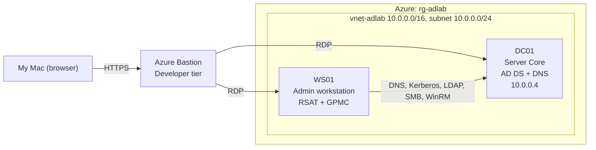

## Build Summary
- Azure: Cloud used to host the lab
- Resource Group (rg-adlab): Folder holding every piece of the lab
- Virtual Network (vnet-adlab): Private network used by the VMs
- DC01 (Domain Controller): The server running Active Directory in the lab
- WS01: Admin workstation and employee computer for the lab
- GPOs: Rules I defined in the domain controller that pushed to machines and users
- PowerShell Script: Automates new user onboarding

## AD structure
- **Organizational Units:**
    - Workstations, Disabled Users, Departments, IT, Finance, HR
    - WS01 sits in the `Workstations` OU instead of the default `Computers` folder because the `Computers` folder isn't an OU so GPOs cannot be linked to it
- **Groups:**
    - SG-IT, SG-Finance, SG-HR
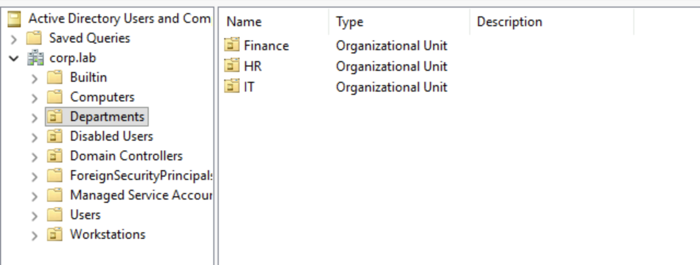

## Group Policy Objects
**1. Account Lockout Policy**
- After 5 invalid login attempts to an account, it is locked out for 15 minutes. Login attempt counter is reset after 15 minutes
- Lockout settings are set at the domain level because password and lockout rules for domain accounts only take effect from there
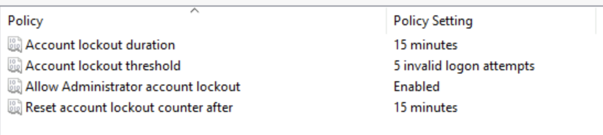

**2. Workstation Logging**
- Logs PowerShell Script Block Logging, scheduled task creation, and failed logins
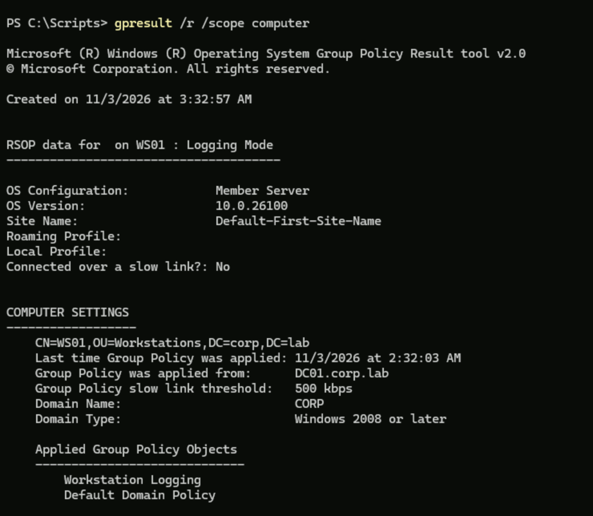

## Lockout Test
- In the IT OU, created a test account called `testuser` and ran a mini brute-force attack (failing its login 6 times in a row) on it to test whether or not the lockout policy actually works.
- Attempts 1 to 5 returned error 1326 (wrong password) and attempt 6 returned 1909 (account locked), proving the policy worked
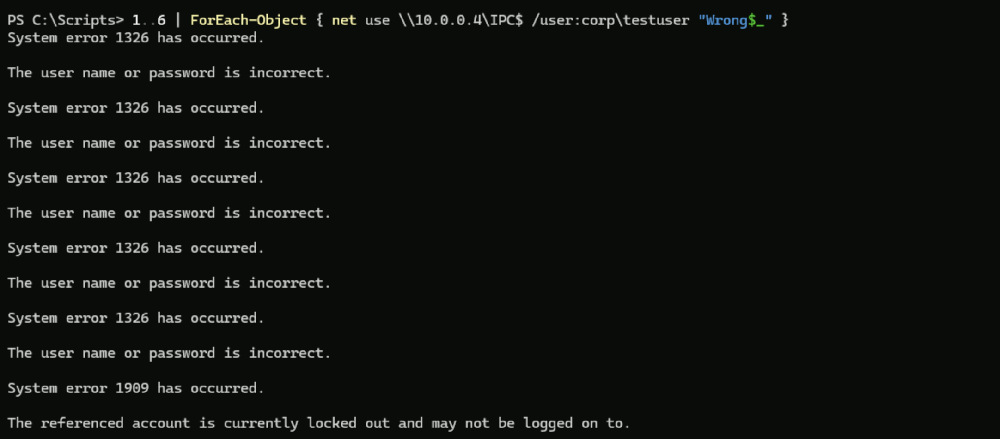
- I then searched for and unlocked the account. Unlocking an account is a common help desk ticket
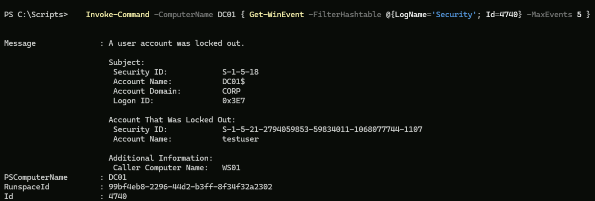
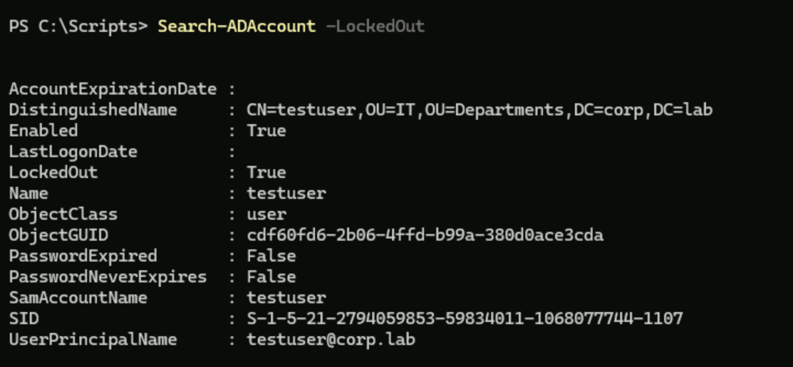
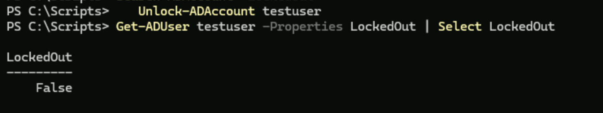

## Provisioning Script
- The PowerShell provisioning script reads a file called `users.csv` that has each person's name, department and title. It then creates each user in their department’s OU, adds them to the department group, and sets a temporary password they must change at first login. It skips users who already exist and logs what it did
- Run the script on a domain-joined machine with the AD tools installed, as a domain admin
- CSV columns: `FirstName,LastName,Department,Title`

  ```powershell
  .\New-LabUsers.ps1
  ```

**1st run output:**
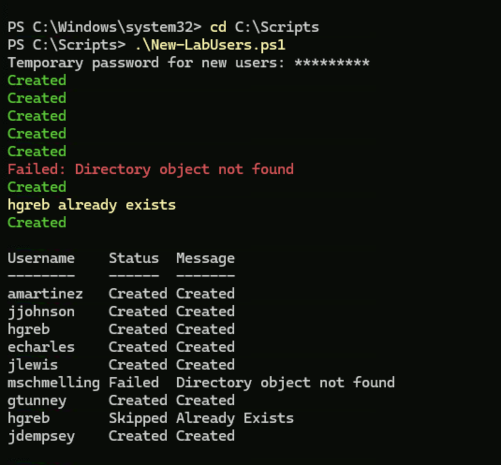

**1st run results CSV:**
  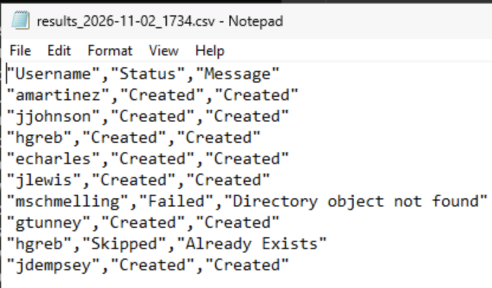
  
**2nd run output (Once accounts are already created):**
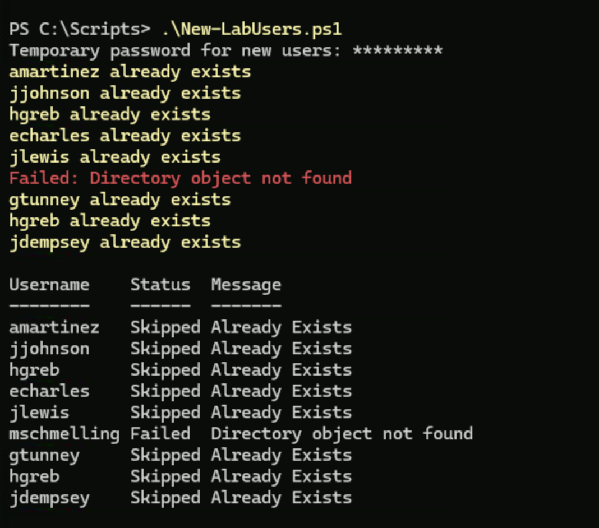

**2nd run results CSV:**
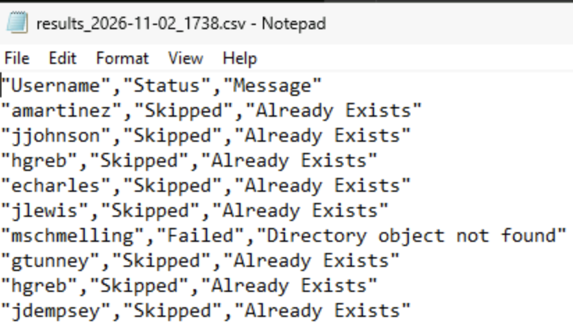


## Troubleshooting & Choices
- Tracked down the hidden Azure region policy which did not allow me to deploy the virtual network because I was in the wrong region for my subscription
- Chose B2als_v2 for its 4 GB of RAM
- Repeating the same wrong password only raised bad logon count to 3, so the account never locked. I instead used a different password each time to lock the account
- Used Bastion so that neither VM needs a public IP and nothing is exposed to the internet
