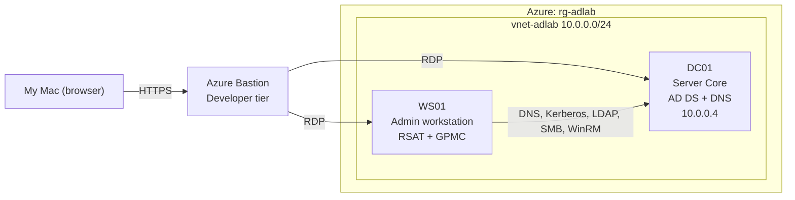

# Azure Active Directory Lab
An Active Directory domain controller with group policy objects and a Powershell user provisioning script to automate new user onboarding.

I built this to practice the Windows and AD admin work done in IT Operations.

## Architecture:

