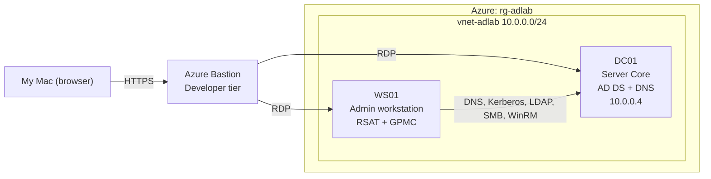

# Azure Active Directory Lab
A small company network: Active Directory domain controller with group policy objects and a Powershell user provisioning script.

I built this to practice the Windows and AD admin work done in IT Operations.

## Architecture

## Build Summary
- Azure: Cloud used to host the lab
- Resource Group (rg-adlab): Folder holding every piece of the lab
- Virtual Network(vnet-adlab): Private network used by the VMs
- DC01 (Domain Controller): The sever running Active Directory in the lab
- WS01: Admin workstation and employee computer for the lab
- GPOs: Rules I defined in the domain controller that pushed to machines and users
- Powershell Script: Automates new user onboarding

## AD structure
- **Organizational Units:**
- Workstations, Disabled Users, Departments, IT, Finance, HR
- WS01 sits in the `Workstations` OU instead of the default `Computers` folder because the `Computers` folder isn't an OU so GPO's cannot be linked to it
- **Groups:**
- SG-IT, SG-Finance, SG-HR

## Group Policy Objects
**1. Account Lockout Policy**
- After 5 invalid login attempts accounts is locked out for 15 minutes. Login attempt counter is reset after 15 minutes
- Lockout settings are set at the domain level because password and lockout rules for domain accounts only take effect from there
**2. Workstation Logging**
- Logs PowerShell Script Block Logging, scheduled task creation, and failed logins

## Lockout Test
In the IT OU, created a test account called `testuser` and ran a mini brute-force attack (failing its login 6 times in a row) on it to test whether or not the lockout policy actually works.

## Provisioning Script
Powershell provisioning script which automates new user onboarding.
It reads a file called `users.csv` that has each person's name, department and title.

## Troubleshooting

## Cost + Security Choices
