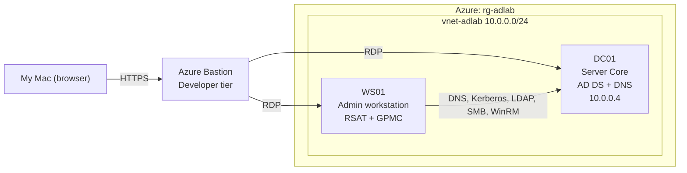

# Azure Active Directory Lab
A small company network: Active Directory domain controller with group policy objects and a Powershell user provisioning script.

I built this to practice the Windows and AD admin work done in IT Operations.

## Architecture

## Build Summary
- Azure: Cloud used to host the lab
- Resource Group (rg-adlab): Folder holding every piece of the lab
- Virtual Network(vnet-adlab): Private network used by the VMs
- DC01 (Domain Controller): The sever running Active Directory in the lab
- WS01: Admin workstation and employee computer for the lab
- GPOs: Rules I defined in the domain controller that pushed to machines and users
- Powershell Script: Automates new user onboarding

## AD structure

## Group Policy

## Lockout Test

## Provisioning Script

## Troubleshooting

## Cost + Security Choices
